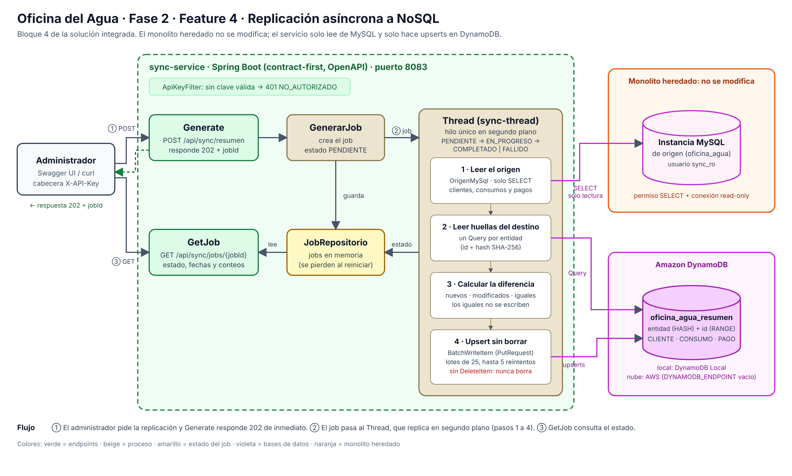

Nombre: Karen Yamileth Jiménez Galicia  
Carnet: 0905-23-7626  
Repositorio: https://github.com/oficina-agua-keko/oficina-agua-sync-nosql  
Modulo asignado: Replicación asíncrona a NoSQL  

# Oficina del Agua — Fase 2 · Feature 4: Replicación asíncrona a NoSQL

Fase 2 · Desarrollo Web 2026 · Universidad Mariano Gálvez

Servicio que copia un **resumen** de la Oficina del Agua (clientes, consumos y pagos) desde la
instancia MySQL hacia **Amazon DynamoDB**, sin hacer esperar a quien lo pide. `POST /api/sync/resumen`
responde de inmediato con `202 Accepted` y un `jobId`; la replicación corre en segundo plano y
`GET /api/sync/jobs/{jobId}` informa en qué estado va. La replicación calcula la diferencia y aplica
**solo upserts: nunca borra** registros del destino.

<!-- Si participaste en otros módulos, agrega aquí una línea, por ejemplo: «Además de este módulo participé en la Feature 1 · Consulta pública con captcha.» -->

**Contenido:** [1. Arquitectura de la solución integrada](#1-arquitectura-de-la-solución-integrada) ·
[2. Cómo se ejecuta la solución integrada](#2-cómo-se-ejecuta-la-solución-integrada) ·
[3. Mi módulo: replicación asíncrona a NoSQL](#3-mi-módulo-replicación-asíncrona-a-nosql) ·
[4. Evidencias](#4-evidencias) ·
[5. Seguridad](#5-seguridad-de-la-información) ·
[6. Equipo y flujo de trabajo](#6-equipo-y-flujo-de-trabajo)

---

## 1. Arquitectura de la solución integrada

La Fase 2 agrega **cuatro features nuevas al lado del monolito heredado**. Cada feature vive en
su propio repositorio y se ejecuta con su propio `docker-compose.yml`; se comunican por HTTP,
por colas de mensajes o por lectura de bases de datos, según el caso.


*Si la imagen no carga, está en [`docs/arquitectura-fase2.png`](docs/arquitectura-fase2.png). Esta
feature es el bloque **4 — Replicación asíncrona a NoSQL**.*

### Repositorios

| Componente | Repositorio |
|---|---|
| Monolito heredado (CodeIgniter 4, PHP 8.2) | [proyecto-agua-keko](https://github.com/KravenTA/proyecto-agua-keko) |
| Feature 1 · Consulta pública con captcha | [oficina-agua-consulta-publica](https://github.com/oficina-agua-keko/oficina-agua-consulta-publica) |
| Feature 2 · Chatbot con RAG | [proyecto-agua-chatbot-rag](https://github.com/oficina-agua-keko/proyecto-agua-chatbot-rag) |
| Feature 3 · Envío de pagos a sistemas externos | [oficina-agua-envio-pagos](https://github.com/oficina-agua-keko/oficina-agua-envio-pagos) |
| Feature 4 · Replicación asíncrona a NoSQL | [oficina-agua-sync-nosql](https://github.com/oficina-agua-keko/oficina-agua-sync-nosql) (este repositorio) |

### Monolito heredado

Sistema existente en **CodeIgniter 4 (PHP)** con su base MySQL de la Oficina del Agua
(clientes, contadores, lecturas, recibos, pagos). **No se modifica su código ni sus tablas
existentes.** Las features lo consultan de forma indirecta:

- Feature 1 usa una **réplica** cargada con un dump, nunca la base original.
- Feature 4 (esta) lee la instancia MySQL de origen con un usuario de **solo lectura** (`SELECT`).
- Feature 3 lee los pagos pendientes con un usuario de solo lectura sobre una **vista**
  (`v_pagos_envio`). Los únicos objetos nuevos que sus scripts de `db/` agregan en esa base
  son la tabla `pagos_envio` (marcas de entrega) y esa vista, con usuarios de permisos mínimos
  (`pagos_ro`: `SELECT` sobre la vista; `lambda_flags`: `INSERT` sobre `pagos_envio`).

### Componentes por feature

| Feature | Componentes | Tecnología |
|---|---|---|
| **1 · Consulta pública** | Página pública con captcha · ApiRest de consulta · Réplica MySQL | Next.js · Spring Boot · MySQL |
| **2 · Chatbot con RAG** | Widget de chat y BFF · ApiRest del chatbot · Vector database · Proceso de ingesta (chunk + embeddings) · LLM · DynamoDB del chatbot | Paquete `oficina-agua-chat-widget` · Spring Boot · PostgreSQL + pgvector · API externa de LLM y embeddings · DynamoDB |
| **3 · Envío de pagos** | Producer · cola · Consumer · Bancos y ERP (sistemas externos) · DynamoDB de logs · Lambda | Spring Boot · RabbitMQ · DynamoDB · Python |
| **4 · Replicación a NoSQL** | sync-service (Generate, GenerarJob, Thread, GetJob) · instancia MySQL de origen · DynamoDB | Spring Boot · MySQL · DynamoDB |

Las features **2 (chatbot)** y **4 (replicación)** también están desplegadas en AWS; ver
[«Qué está desplegado en AWS»](#qué-está-desplegado-en-aws) en la sección 2.

### Qué representa cada conexión

| Flujo | Recorrido |
|---|---|
| **1 · Consulta pública** | Navegador → página Next.js (valida el captcha **en servidor**) → `http` → ApiRest (rate limit por IP) → **Réplica MySQL** (solo lectura). La réplica se carga con un dump de la base del monolito mediante `scripts/refrescar-replica.ps1`. |
| **2 · Chat con RAG** | Documentos Markdown (`content/`) → *chunk* → *embeddings* → vector database (ingesta, una vez). En cada pregunta: navegador → widget en la página de la Feature 1 → BFF `/api/chat` → `http` → ApiRest del chatbot → búsqueda en pgvector → *prompt* al LLM externo → respuesta con fuentes. Cada *prompt/response* se guarda en DynamoDB del chatbot. |
| **3 · Envío de pagos** | Producer lee los pagos pendientes por medio de un flag (vista sobre la base de pagos) → publica en RabbitMQ (`pagos.banco`, `pagos.erp`) → Consumer entrega a Bancos y ERP con reintentos con *backoff* y reconciliación con GET → los resultados exitosos y fallidos van a DynamoDB de logs → su *stream* dispara la Lambda → la Lambda marca el envío en `pagos_envio` para que no se reenvíe. Los mensajes que agotan sus reintentos van a `pagos.dlq`. |
| **4 · Replicación a NoSQL** | `POST /api/sync/resumen` (Generate) → GenerarJob crea el *job* `PENDIENTE` y responde `202` con su `jobId` → el Thread de segundo plano lee la instancia MySQL (solo lectura), compara contra DynamoDB y hace *upserts* → `GET /api/sync/jobs/{jobId}` (GetJob) consulta el estado y los conteos. |

### Cómo leer el diagrama frente a la implementación

- El **chat de la Feature 2 no es una página aparte**: el widget y su BFF se montan dentro de la
  aplicación Next.js de la Feature 1 (HU-59). El diagrama los dibuja como bloque separado
  porque son dos features distintas.
- En local, DynamoDB corre como **DynamoDB Local**, los sistemas externos (Bancos y ERP) se
  simulan con **WireMock** y el broker es **RabbitMQ**.
- En el bloque 4, *Generate* y *GetJob* son los dos endpoints del servicio (`POST /api/sync/resumen`
  y `GET /api/sync/jobs/{jobId}`), *GenerarJob* es la clase que registra el job y *Thread* es el hilo
  de segundo plano (`sync-thread`) que replica. Los cuatro viven dentro del mismo `sync-service`.
- Los *embeddings* y el LLM del chatbot se consumen de una API externa; su clave nunca se
  versiona ni llega al navegador.

---

## 2. Cómo se ejecuta la solución integrada

No existe un `docker-compose.yml` único: **cada feature tiene el suyo**, y se levantan una a
una. Todos los puertos son configurables por variables de entorno, así que las cuatro pueden
convivir en la misma máquina.

**Requisitos:** Docker Desktop, Git, Java 21 o superior y Maven 3.9+ (producer y consumer de la
Feature 3; el ApiRest del chatbot trae su propio `mvnw`) y Node 22+ solo para correr las
pruebas de la capa web. **Esta feature (la 4) solo necesita Docker y Git.**

### Puertos usados en la prueba integrada

| Feature | Servicio | Puerto |
|---|---|---|
| 1 | web · api · réplica MySQL | 3000 · 8081 · 3307 |
| 2 | ApiRest del chatbot (`SERVER_PORT`) · pgvector · DynamoDB · Swagger UI | 8084 · 5433\* · 8000 · 8082 |
| 3 | RabbitMQ (AMQP / consola) · DynamoDB · banco falso · ERP falso · producer · consumer · base de pagos | 5672 / 15672 · 8001 · 8089 · 8090 · 8085 · 8086 · 3309 |
| 4 | sync-service · base de origen · DynamoDB | 8083 · 3308 · 8002 |

\* El puerto por defecto de pgvector es `5432`. Si en tu máquina hay un PostgreSQL instalado,
cámbialo con `POSTGRES_PORT` y apunta la API con `VECTOR_DB_URL`.

En la prueba integrada la Feature 4 usa `DYNAMODB_HOST_PORT=8002` para no chocar con el DynamoDB
local de la Feature 2 (8000). Sola, el valor por defecto de `.env.example` es `8000`.

### Qué está desplegado en AWS

De la solución integrada, dos features están además **desplegadas en AWS (`us-east-1`)**:

| Feature | En AWS |
|---|---|
| **2 · Chatbot con RAG** | Desplegado en AWS. Su detalle está en el repositorio [proyecto-agua-chatbot-rag](https://github.com/oficina-agua-keko/proyecto-agua-chatbot-rag). |
| **4 · Replicación asíncrona a NoSQL** | Desplegada en AWS: `sync-service` en EC2 y destino en Amazon DynamoDB. Ver la [sección 3.5](#35-despliegue-en-aws). |

Las demás features (1 y 3) se ejecutan con su propio `docker-compose.yml`, como se explica abajo.

### Orden de arranque

**Feature 4** (esta; solo Docker):
```bash
git clone https://github.com/oficina-agua-keko/oficina-agua-sync-nosql.git
cd oficina-agua-sync-nosql
cp .env.example .env     # SYNC_API_KEY=<una clave local>, DYNAMODB_HOST_PORT=8002 si corren las demás
docker compose up -d --build
```

**Feature 1** (consulta pública):
```bash
git clone https://github.com/oficina-agua-keko/oficina-agua-consulta-publica.git
cd oficina-agua-consulta-publica
cp .env.example .env     # ajustar valores; nunca subir el .env
docker compose up -d --build
powershell -ExecutionPolicy Bypass -File scripts\refrescar-replica.ps1   # carga la réplica
```

**Feature 2** (chatbot):
```bash
git clone https://github.com/oficina-agua-keko/proyecto-agua-chatbot-rag.git
cd proyecto-agua-chatbot-rag
cp .env.example .env
docker compose up -d                       # pgvector, DynamoDB, Swagger UI
cp api/secrets.properties.example api/secrets.properties
# editar api/secrets.properties y poner chatbot.llm.api-key=<tu clave> (archivo no versionado)
cd api
./mvnw spring-boot:run -Dspring-boot.run.arguments=--ingesta   # solo la primera vez
SERVER_PORT=8084 ./mvnw spring-boot:run                        # deja esta terminal abierta
```
En Windows (PowerShell): `$env:SERVER_PORT=8084` y `.\mvnw.cmd`. El ApiRest de la Feature 1
ya usa el 8081, por eso el chatbot corre en el 8084 y `CHAT_API_URL` apunta a él.

**Feature 3** (envío de pagos): necesita una base MySQL/MariaDB con las tablas del monolito y
los scripts de `db/` aplicados (`00-pagos_envio.sql`, `01-v_pagos_envio.sql`,
`02-usuarios.sql`). Para probar sin tocar la base real puede usarse un MariaDB desechable
cargado con los scripts de [`db/origen/`](db/origen) **de esta feature**. Después:
```bash
git clone https://github.com/oficina-agua-keko/oficina-agua-envio-pagos.git
cd oficina-agua-envio-pagos
cp .env.example .env      # puertos, usuarios de base y RabbitMQ (ver README del repositorio)
docker compose up -d --build        # RabbitMQ, DynamoDB, simuladores y Lambda
cd consumer && SERVER_PORT=8086 mvn spring-boot:run    # terminal 1
cd producer && SERVER_PORT=8085 mvn spring-boot:run    # terminal 2
```

Cada repositorio detalla sus variables en su `.env.example` y su README.

---

## 3. Mi módulo: replicación asíncrona a NoSQL

### 3.1 Funcionalidad y objetivo

**Problema del negocio.** Los datos de la Oficina del Agua (clientes, lecturas y pagos) viven en la
base MySQL del monolito, que es la que cobra y registra pagos. Cualquier sistema que necesite
consultar un resumen de esos datos no debe hacerlo contra esa base ni hacer esperar al
administrador mientras se copian. La Feature 4 deja una **copia de lectura en NoSQL (DynamoDB)**,
actualizada bajo demanda y sin tocar el monolito: quien la pide recibe una respuesta inmediata y
consulta después cómo va.

**Qué se construyó.** El `sync-service` (Spring Boot, *contract-first* con OpenAPI) y su entorno:

| Pieza | Qué hace |
|---|---|
| **Generate** · `POST /api/sync/resumen` | Pide una replicación y responde `202 Accepted` con el `jobId` y la ruta para consultarlo (cabecera `Location`). No espera a que termine. |
| **GenerarJob** | Crea el *job* en estado `PENDIENTE`, lo guarda y lo entrega al Thread. |
| **Thread** (`sync-thread`) | Hilo único de segundo plano. Lee el origen, calcula la diferencia y escribe en DynamoDB, llevando el job por sus estados. |
| **GetJob** · `GET /api/sync/jobs/{jobId}` | Devuelve el estado, las fechas y, al terminar, cuántos registros se insertaron, actualizaron o quedaron sin cambios. |
| Instancia MySQL de origen (`db/origen/`) | Copia local de la base del monolito con un usuario de **solo lectura**. |
| DynamoDB (`dynamodb/`) | Destino: una sola tabla `oficina_agua_resumen`. |

```
 Administrador
     │ POST /api/sync/resumen                      GET /api/sync/jobs/{jobId}
     ▼                                                       │
  Generate ──► GenerarJob ──► Thread (segundo plano)         ▼
  (202 + jobId)  (PENDIENTE)      │                       GetJob
                                  │ lee (solo lectura)       ▲ estado, fechas y conteos
                                  ▼                          │
                         Instancia MySQL ──► diff ──► upsert ──► Amazon DynamoDB
                                           (nuevos / modificados / iguales)
```



*Si la imagen no carga, está en [`docs/diagrama-feature4.png`](docs/diagrama-feature4.png).*

**Qué se replica.** Tres tipos de dato, siempre sin datos sensibles (nunca DPI, NIT, teléfono,
correo ni documentos):

| Entidad | Sale de la tabla | Atributos replicados |
|---|---|---|
| `CLIENTE` | `clientes` | `nombre`, `direccion`, `activo` |
| `CONSUMO` | `lecturas` | `clienteId`, `contador`, `periodo` (AAAA-MM), `lecturaAnterior`, `lecturaActual`, `consumo`, `monto`, `fechaLectura` |
| `PAGO` | `pagos` | `clienteId`, `lecturaId`, `recibo`, `monto`, `fechaPago`, `metodo` |

**Cómo funciona una replicación.** Por cada tipo de dato:

1. **Leer el origen** con el usuario de solo lectura; solo se piden los campos del resumen.
2. **Leer las huellas del destino**: un `Query` por `entidad` que trae el `hash` de cada registro.
3. **Calcular la diferencia**: cada registro tiene una huella SHA-256 de sus datos. Id ausente en
   DynamoDB → *nuevo*; huella distinta → *modificado*; misma huella → *igual* (no se escribe).
4. **Aplicar upserts** con `BatchWriteItem` (`PutRequest`) en lotes de hasta 25. Si DynamoDB deja
   registros sin escribir (`UnprocessedItems`), se reintentan con espera creciente, hasta 5 intentos
   por lote. **No existe ninguna operación de borrado**: un registro que desapareció del origen se
   queda en el destino.

Estados del job: `PENDIENTE` → `EN_PROGRESO` → `COMPLETADO` o `FALLIDO`. Si falla, el job queda
`FALLIDO` con un motivo legible y sin detalles internos (por ejemplo, *No se pudo consultar el
destino en DynamoDB.*); el fallo no tumba al Thread ni afecta al origen, y la siguiente ejecución se
recupera sola. Ejecutar la replicación dos veces seguidas da el mismo resultado.

### 3.2 Integración y responsabilidades

| Componente | Se comunica con | Por qué esa frontera |
|---|---|---|
| Cliente (administrador, Swagger UI, `curl`) | `sync-service` por `http`, con la cabecera `X-API-Key` | La API exige clave: si `SYNC_API_KEY` no está definida, **rechaza todo con 401** (mejor no responder que dejarla abierta por un olvido). |
| `sync-service` | Instancia MySQL de origen | Usuario con permiso **`SELECT` únicamente** y conexiones marcadas `read-only`. Aunque el servicio se comprometiera, no podría modificar la base que cobra y registra pagos. |
| `sync-service` | Amazon DynamoDB | Solo `Query` y `BatchWriteItem` con `PutRequest`. Sin `DeleteItem`: la copia nunca pierde datos por un error en el origen. |
| `db/origen/` | Se carga con el esquema y los datos del monolito | El monolito heredado **no se modifica**: aquí solo hay una copia de sus datos para el entorno local (generada con sus migraciones y seeders). |
| Feature 3 (envío de pagos) | Reutiliza los scripts de `db/origen/` | Para probar sin tocar la base real, la Feature 3 puede cargar un MariaDB desechable con ellos. |

Reglas que se cumplen: el monolito heredado no se modifica; el servicio solo lee de MySQL con un
usuario de solo lectura; DynamoDB solo recibe upserts; ninguna clave se versiona (todo por variables
de entorno, ver `.env.example`); el motivo de un fallo nunca revela URLs, usuarios ni SQL; ningún
dato sensible del cliente se replica. Esta feature no usa colas ni Next.js: su integración es
HTTP → MySQL → DynamoDB.

### 3.3 Decisiones técnicas

**a) Responder `202` con un `jobId` y replicar en un hilo de segundo plano, en vez de hacerlo dentro
de la petición.** Replicar todo el resumen puede tardar según el volumen y depende de dos sistemas
externos (MySQL y DynamoDB). Hacerlo dentro del `POST` dejaría al cliente esperando, expuesto a
*timeouts*, y un corte a mitad de petición no dejaría rastro de qué pasó. Con el job, el `POST`
responde en menos de un segundo y el estado queda consultable. Se usa **un solo hilo** a propósito:
los jobs se procesan uno tras otro, así dos replicaciones nunca escriben el mismo registro a la vez.
El costo es que los jobs viven en memoria y se pierden al reiniciar el servicio.

**b) Detectar cambios con una huella SHA-256 y aplicar solo upserts, sin borrar.** En lugar de
reescribir todo el resumen en cada ejecución, se compara la huella de cada registro con la que ya
está en DynamoDB y solo se escribe lo nuevo o modificado. Esto reduce las escrituras (que en
DynamoDB se pagan), hace la operación **idempotente** (la segunda ejecución encuentra todo igual) y
permite informar conteos exactos. Se descartó sincronizar también los borrados porque una copia que
borra automáticamente convierte un error o un filtro mal puesto en el origen en pérdida de datos en el
destino; es más seguro conservar y decidir la limpieza aparte.

**c) Una sola tabla con clave `entidad` (partición) + `id` (ordenamiento).** Los tres tipos de dato
comparten la tabla `oficina_agua_resumen`. Traer todos los registros de un tipo es un único `Query`
por `entidad`, que es justo lo que necesita la comparación, y un upsert es un `PutRequest` con la
misma clave. Se eligió modo `PAY_PER_REQUEST` para no tener que dimensionar capacidad en una carga
esporádica y bajo demanda.

**d) Un mismo código para DynamoDB Local y para AWS.** Si `DYNAMODB_ENDPOINT` tiene valor, el
cliente apunta a DynamoDB Local con credenciales de ejemplo; si está vacío, usa DynamoDB de AWS con
las credenciales del entorno (rol IAM o variables). Así no hay una versión «de desarrollo» y otra
«de producción» del código, y las credenciales reales nunca están en el repositorio.

### 3.4 Instrucciones para probar el módulo

**Requisitos previos:** Docker Desktop y Git. No hace falta Java ni Maven (el servicio se compila
dentro de Docker). **Datos de prueba:** los de [`db/origen/`](db/origen) — 25 clientes, 32 consumos
y 4 pagos de ejemplo (61 registros en total), sin datos sensibles reales. La API key es la que
pongas en `SYNC_API_KEY` dentro de tu `.env`.

**1. Levantar los servicios**

```bash
git clone https://github.com/oficina-agua-keko/oficina-agua-sync-nosql.git
cd oficina-agua-sync-nosql
cp .env.example .env            # en Windows CMD: copy .env.example .env
docker compose up -d --build
```

Levanta DynamoDB Local con su tabla (`dynamodb`, `dynamodb-init`), la instancia MySQL de origen
(`mysql-origen`) y el `sync-service` en el puerto `8083`. La primera vez tarda unos minutos.
Comprobar la tabla: `docker compose logs dynamodb-init` debe terminar con
`Tabla oficina_agua_resumen creada.`

**2. Abrir Swagger UI:** <http://localhost:8083/swagger-ui.html>. Pulsar **Authorize**, escribir la
API key y usar **Try it out**; o seguir con `curl` (en PowerShell, `curl.exe`):

**3. Pedir una replicación**

```bash
curl -i -X POST http://localhost:8083/api/sync/resumen -H "X-API-Key: cambiar_esta_api_key"
```

**Esperado:** `202 Accepted`, cabecera `Location: /api/sync/jobs/<jobId>` y un cuerpo con el
`jobId` y `"estado": "PENDIENTE"`. Responde de inmediato.

**4. Consultar el job**

```bash
curl -s http://localhost:8083/api/sync/jobs/<jobId> -H "X-API-Key: cambiar_esta_api_key"
```

**Esperado:** `"estado": "COMPLETADO"` con `finalizadoEn` y los conteos: 61 insertados en total
(25 clientes, 32 consumos, 4 pagos), 0 actualizados, 0 sin cambios. Si se consulta muy rápido puede
verse antes `EN_PROGRESO`.

**5. Comprobar que quedó en DynamoDB** (con la AWS CLI; las credenciales pueden ser `local`):

```bash
aws dynamodb scan --table-name oficina_agua_resumen --select COUNT \
  --endpoint-url http://localhost:8000 --region us-east-1
```

**Esperado:** `"Count": 61` (usa el puerto de `DYNAMODB_HOST_PORT`, 8000 por defecto).

**6. Repetir la replicación.** Hacer otro `POST` y consultar su job. **Esperado:** `COMPLETADO` con
0 insertados, 0 actualizados y 61 sin cambios: no escribe nada.

**7. Probar la API key.** `curl -i -X POST http://localhost:8083/api/sync/resumen` (sin cabecera).
**Esperado:** `401` con el código `NO_AUTORIZADO`.

**8. Probar que el origen es de solo lectura:**

```bash
docker exec -it sync-mysql-origen mysql -usync_ro -p oficina_agua -e "INSERT INTO clientes (nombre) VALUES ('prueba');"
```

(la contraseña es `ORIGEN_DB_PASSWORD` de tu `.env`). **Esperado:** `INSERT command denied`.

**Pruebas automatizadas**

```powershell
powershell -ExecutionPolicy Bypass -File .\pruebas\integracion.ps1
```

Levanta la feature desde cero (**borra los datos locales**) y comprueba de punta a punta 20 casos:
destino vacío, repetición sin cambios, cambios parciales, que nunca borra, fallo del destino
(DynamoDB caído) con recuperación y que no se replican datos sensibles. Guarda el reporte en
[`docs/evidencias/`](docs/evidencias). Las pruebas unitarias del servicio se corren con JDK 21 y
Maven: `cd sync-service && mvn test`.

| Qué | Dónde |
|---|---|
| Swagger UI | <http://localhost:8083/swagger-ui.html> |
| Contrato OpenAPI | <http://localhost:8083/openapi/sync-api.yaml> y [`sync-service/openapi/sync-api.yaml`](sync-service/openapi/sync-api.yaml) |
| Logs del servicio | `docker compose logs -f sync-service` |
| Detener todo | `docker compose down` |
| Empezar de cero (borra los datos) | `docker compose down -v` |

Más detalle del servicio en [`sync-service/README.md`](sync-service/README.md), de DynamoDB en
[`dynamodb/README.md`](dynamodb/README.md) y del origen en [`db/origen/README.md`](db/origen/README.md).

### 3.5 Despliegue en AWS

En AWS están desplegados el **chatbot con RAG (Feature 2)** y la **replicación asíncrona a NoSQL (Feature 4)**. Esta sección detalla la Feature 4, que usa **Amazon DynamoDB real** como destino; el despliegue del chatbot se documenta en su repositorio.

| Pieza | Dónde corre |
|---|---|
| `sync-service` | Contenedor Docker en una instancia **Amazon EC2**, región `us-east-1` |
| Instancia MySQL de origen | Contenedor `mysql-origen` en la misma EC2 (copia de la base del monolito, usuario de solo lectura) |
| Destino | **Amazon DynamoDB** (servicio de AWS, no Local), región `us-east-1`, tabla `oficina_agua_resumen` |
| URL del servicio | <http://184.195.180.87/swagger-ui.html> (el servicio se publica en el puerto 80 de la EC2) |

```
Administrador ──http:80──► EC2 (us-east-1)
                           ├─ sync-service ──SELECT──► mysql-origen (contenedor)
                           └─ sync-service ──Query / BatchWriteItem──► Amazon DynamoDB (oficina_agua_resumen)
                                              (credenciales: rol IAM de la instancia)
```

**Qué cambia respecto a la versión local.** El código es el mismo. Lo único distinto es la
configuración, y vive en [`docker-compose.aws.yml`](docker-compose.aws.yml):

- **No se levanta DynamoDB Local.** `DYNAMODB_ENDPOINT` va **vacío**: con eso el servicio usa
  DynamoDB de AWS y toma las credenciales del entorno (`DefaultCredentialsProvider`).
- **Sin claves en el servidor ni en el repositorio.** La EC2 tiene un **rol IAM** con permisos
  mínimos, solo sobre una tabla:

```json
{
  "Version": "2012-10-17",
  "Statement": [{
    "Effect": "Allow",
    "Action": ["dynamodb:Query", "dynamodb:BatchWriteItem"],
    "Resource": "arn:aws:dynamodb:us-east-1:<ID_CUENTA>:table/oficina_agua_resumen"
  }]
}
```

- El límite de saltos de los metadatos de la instancia es 2, para que los contenedores Docker
  alcancen el rol IAM.
- El servicio se publica en el puerto 80 (`80:8083`), abierto en el grupo de seguridad.

**Pasos del despliegue**

1. Crear la tabla en DynamoDB (misma clave que en local, sin `--endpoint-url`):
   ```bash
   aws dynamodb create-table --table-name oficina_agua_resumen \
     --attribute-definitions AttributeName=entidad,AttributeType=S AttributeName=id,AttributeType=S \
     --key-schema AttributeName=entidad,KeyType=HASH AttributeName=id,KeyType=RANGE \
     --billing-mode PAY_PER_REQUEST --region us-east-1
   ```
2. Crear el rol IAM con la política anterior y asignarlo a la instancia EC2.
3. En la EC2: instalar Docker y Git, y clonar el repositorio.
4. Crear el `.env` en el servidor (`cp .env.example .env`) con contraseñas y una `SYNC_API_KEY`
   propias. **El `.env` real no se sube al repositorio.**
5. Levantar el servicio:
   ```bash
   docker compose -f docker-compose.aws.yml up -d --build
   docker compose -f docker-compose.aws.yml logs -f sync-service
   ```

**Cómo probarlo en AWS**

1. Abrir <http://184.195.180.87/swagger-ui.html>, pulsar **Authorize** y escribir la API key
   (no se publica aquí; se entrega por la plataforma o a solicitud).
2. Ejecutar `POST /api/sync/resumen`. **Esperado:** `202 Accepted` con el `jobId`.
3. Consultar `GET /api/sync/jobs/{jobId}`. **Esperado:** `COMPLETADO` con 61 registros insertados
   (25 clientes, 32 consumos y 4 pagos) en la primera ejecución.
4. Ver los datos en la consola de AWS: **DynamoDB → Tables → `oficina_agua_resumen` → Explore
   table items** (región `us-east-1`). Debe haber 61 ítems, y `entidad` = `CLIENTE`, `CONSUMO` o
   `PAGO`. O con la AWS CLI:
   ```bash
   aws dynamodb scan --table-name oficina_agua_resumen --select COUNT --region us-east-1
   ```
5. Repetir el `POST`. **Esperado:** `COMPLETADO` con 0 insertados, 0 actualizados y 61 sin cambios.

<!-- Capturas del despliegue: guárdalas en docs/img/ y descomenta estas líneas.


-->

---

## 4. Evidencias

El reporte completo de las pruebas de integración (HU-58) está en
[`docs/evidencias/pruebas-integracion-2026-10-21_0116.md`](docs/evidencias/pruebas-integracion-2026-10-21_0116.md):
**20 de 20 comprobaciones aprobadas**, con el entorno levantado desde cero en Docker Compose
(origen: 25 clientes, 32 consumos y 4 pagos).

| Caso | Resultado obtenido |
|---|---|
| 1. Destino vacío | Job `COMPLETADO`: 25 + 32 + 4 insertados; DynamoDB con 61 de 61 registros |
| 2. Repetición sin cambios | 0 insertados, 0 actualizados, 61 sin cambios |
| 3. Cambios parciales | 1 cliente insertado, 1 actualizado y 1 pago actualizado; la dirección nueva llega a DynamoDB |
| 4. Nunca borra | Un cliente borrado del origen sigue en DynamoDB (62 registros) |
| 5. Fallo del destino | Con DynamoDB caído el job queda `FALLIDO` con un motivo sin detalles internos; al volver, se recupera |
| 6. Sin datos sensibles | Ningún registro trae DPI, NIT, teléfono, correo ni documentos |

---

## 5. Seguridad de la información

- Ninguna contraseña, token ni clave de API se versiona: viven en variables de entorno, y el
  repositorio incluye un `.env.example` con valores de ejemplo. El `.env` (y `.env.*`, `*.pem`,
  `*.key`) está en `.gitignore`.
- Las credenciales de DynamoDB Local (`local`) no son reales. En AWS se usan las del entorno, de
  preferencia un rol IAM con permisos mínimos (`Query` y `BatchWriteItem` sobre una sola tabla).
- La API exige la cabecera `X-API-Key`; sin clave configurada rechaza todo con `401`.
- El servicio lee MySQL con un usuario de **solo lectura** (`SELECT`) y conexiones `read-only`.
- Los scripts de `db/origen/` reemplazaron las contraseñas de los usuarios del monolito por `no-aplica`.
- No se replican DPI, NIT, teléfono, correo ni documentos de los clientes.
- Los motivos de fallo de un job no exponen URLs, usuarios ni SQL; el detalle va solo al log.
- La imagen Docker final corre con un usuario sin privilegios y sin credenciales dentro.

---

## 6. Equipo y flujo de trabajo

| Nombre completo | Carnet | Correo electrónico | Rol dentro del equipo |
|---|---|---|---|
| Yourgen Kraven Thommel Arevalo | 0905-23-14003 | ythommela@miumg.edu.gt | Coordinador |
| Karen Yamileth Jiménez Galicia | 0905-23-7626 | kjimenezg6@miumg.edu.gt | Desarrolladora |
| Enner Osvaldo Godoy Ramirez | 0905-23-15908 | egodoyr2@miumg.edu.gt | Desarrollador |
| Oliver Isaac Godoy Salguero | 0905-23-10816 | ogodoys@miumg.edu.gt | Desarrollador |

**Proyecto en Jira:** SDGODA · Épica 14 — Feature 4.

### Estructura del repositorio

```
.
├── sync-service/         Servicio Spring Boot: Generate, GenerarJob, Thread, GetJob — HU-51, 53 a 57
├── db/origen/            Instancia MySQL de origen: usuario de solo lectura y datos — HU-55
├── dynamodb/             Amazon DynamoDB Local y creación de la tabla de resumen — HU-52
├── docs/                 Diagrama de arquitectura y evidencia de pruebas — HU-58
├── pruebas/              Pruebas de integración con Docker Compose — HU-58
├── .github/              Plantilla de pull request
├── docker-compose.yml    Orquestación local de la feature
├── docker-compose.aws.yml Despliegue en AWS (EC2 + DynamoDB real)
├── .env.example          Variables de entorno (copiar a .env)
└── README.md
```

### Flujo de trabajo

Se trabaja con ramas y pull requests. **Nunca directo sobre `main`.**

```bash
git checkout main
git pull
git checkout -b feature/SDGODA-XX-descripcion-corta
```

Prefijos de commit: `feat:` funcionalidad nueva · `fix:` correcciones · `chore:` configuración y
mantenimiento · `refactor:` reorganizar sin cambiar comportamiento · `style:` formato ·
`docs:` documentación. Antes de abrir el PR se trae `main` a la rama
(`git fetch origin` y `git merge origin/main`).

### Reglas de esta fase

- El monolito heredado no se toca, ni para agregar un endpoint de lectura.
- El sync-service solo lee de la instancia MySQL, con un usuario de solo lectura.
- La replicación solo aplica upserts: ningún registro existente en DynamoDB se elimina.
- Contract-first: primero el YAML de OpenAPI, después el código.
- Claves y credenciales solo en variables de entorno, documentadas en `.env.example`.

### Documentación elaborada con ayuda de IA

La sección de arquitectura de la solución integrada y la de este módulo se redactaron con ayuda de
un asistente de IA (Claude), a partir de los README, el `docker-compose.yml`, el `.env.example`,
los scripts de base de datos, el contrato OpenAPI y el código del `sync-service`, y se
contrastaron con el reporte de pruebas de integración. Los puertos de la tabla integrada son los de
la prueba conjunta de las cuatro features; los endpoints, estados y flujos de la Feature 4 salen
directamente del código de este repositorio.
